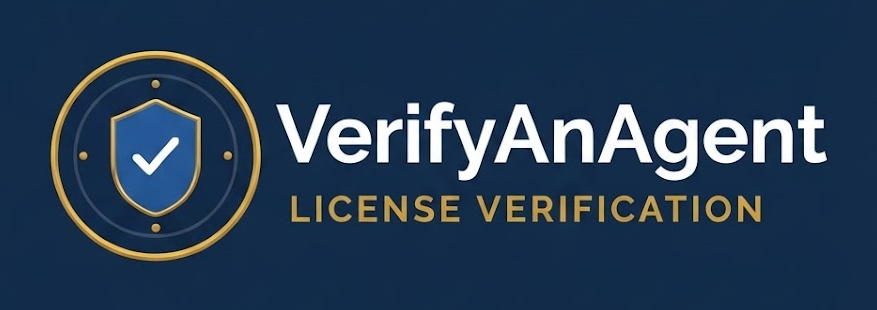

<p align="center">
  
</p>

# VerifyAnAgent

**Serverless pipeline that turns a Stripe payment into a live, verifiable license page for a life insurance agent — with no human in the loop.**

An agent signs up, pays, and minutes later has a site at `https://{name}.verifyanagent.com` showing every state they're licensed in, their certificates, and one-click links to each state's official license lookup. Consumers use it to check that an agent is real before buying a policy.

- **Live demo:** https://judewakim.verifyanagent.com
- **Get one built for you ($300, one-time):** https://verifyanagent.com/get-started

> Don't want to run AWS yourself? That's what the paid service is for. This repo is the engine; the hosted version is set up, reviewed, and maintained for you.

---

## Architecture

```
Signup form ──POST /signup──▶ Admin/Signup Lambda ──▶ Airtable (record: submitted)
     │                               │
     │  presigned PUT (images, PDFs) ▼
     └──────────────────────────▶ S3 (private uploads)
     │
     ▼
Stripe Checkout (client_reference_id = Airtable record ID)
     │  checkout.session.completed
     ▼
API Gateway ──▶ Build Lambda
                  1. Verify Stripe signature
                  2. Load record by ID (not email)
                  3. OCR each license cert (Claude Haiku vision, structured output)
                  4. Build per-state license cards (50-state lookup map)
                  5. Render Jinja2 template ──▶ S3 ──▶ {slug}.verifyanagent.com
                  6. Regenerate sitemap.xml + public agent directory
                  7. Slack alert if anything needs human review
```

| Component | Files |
|---|---|
| Stripe webhook entry point | `handler.py`, `stripe_verifier.py` |
| Shared build pipeline | `builder.py`, `site_generator.py`, `templates/` |
| Certificate OCR + name check | `cert_ocr.py` |
| 50-state license database | `state_data.py` |
| Asset handling | `s3_manager.py` |
| Admin portal + public signup API | `admin_api.py`, `admin/` |
| SEO | `sitemap.py` |
| Operator alerts | `notify.py` |

**Stack:** Python 3 · AWS Lambda · API Gateway · S3 · SSM Parameter Store (KMS) · Stripe · Airtable · Anthropic API · Slack webhooks · PowerShell deploy scripts

---

## Security design

- **Webhook authenticity.** Every Stripe event is signature-verified before any work happens; unsigned or forged requests are rejected immediately.
- **Payment joined by record ID, not email.** Stripe's `client_reference_id` carries the Airtable record ID, so a customer paying with a different email can't break or hijack a build.
- **Admin auth.** Single operator account. The email comes from an env var and fails closed if unset. Passwords are PBKDF2-SHA256 (200k iterations, per-password salt) stored as a KMS-encrypted SecureString in SSM, never in S3 or code. Sessions are stateless HMAC-signed bearer tokens that expire after 12 hours, compared in constant time.
- **Least-privilege public routes.** Unauthenticated signup routes can only touch records still in the `submitted` state; once a record is paid, only the authenticated admin API can change it.
- **Direct-to-S3 uploads.** Images and certificate PDFs go up via short-lived presigned URLs, so file bytes never pass through the API.
- **No secrets in the repo.** All credentials live in Lambda environment variables (see `.env.deploy.example`).
- **Spam guard.** Honeypot field plus optional Cloudflare Turnstile verification (`docs/turnstile-setup.md`).
- **Human review on anomalies.** If OCR misses a license number or the name on a certificate doesn't match the signup, the build still completes but the operator gets a Slack alert with a deep link to fix it.

---

## Running it yourself

You'll need an AWS account, a Stripe account, an Airtable base, and an Anthropic API key.

1. Copy `.env.deploy.example` to `.env.deploy` and fill in your values.
2. Create the S3 bucket and wildcard DNS for your domain.
3. Deploy the build Lambda: `./deploy.ps1`
4. Deploy the admin/signup Lambda: follow `ADMIN_SETUP.md` (or `ADMIN_RUNBOOK.md` for a from-scratch walkthrough).
5. Point a Stripe webhook (`checkout.session.completed`) at the build Lambda's API Gateway URL.

Deeper internals: `docs/DEVELOPER_GUIDE.md`.

**Not included:** the marketing site and signup page (`verifyanagent.com`) live in a separate private repo.

---

## License

[Functional Source License 1.1 (Apache 2.0 future license)](LICENSE.md). You can read, run, modify, and learn from this code for any purpose except offering a competing commercial product or service. Each release converts to Apache 2.0 two years after publication.

Built by [Jude Wakim](https://github.com/Judewakim) — cloud security engineer.
